# Smart Market Delivery Platform Database Schema

## Scope and sources

This schema is based on the Smart Market Delivery Platform requirements in
`Smart_Market_Delivery_Platform_MySQL.pdf`. It models the meal-to-market
ingredient procurement flow: editable recipe ingredients, pantry subtraction,
market selection, dated price estimates, worker shopping, customer-approved
substitutions, payment verification, delivery, receipt, and audit history.

The separate `School_Management_MySQL_Migration_Guide.docx` describes a
different project. It is not treated as a Smart Market requirements source.

This document combines the proposed logical design with the implementation
status known from repository inspection. A previous read-only inspection found
`users`, `roles`, and `user_role` in the live database at Alembic revision
`d4dbb44eb27c`. The repository now includes ORM models and an unapplied
Alembic revision for the first nine business tables listed below. No claim is
made that those nine tables exist in the live database; verify the target
database separately before any migration work.

## Design principles

- Preserve the existing `users`, `roles`, and `user_role` tables and the
  existing Alembic migration history.
- Add platform tables through new forward Alembic revisions; do not recreate
  the database or rewrite existing revisions.
- Use InnoDB, `utf8mb4`, UTC timestamps, integer surrogate primary keys, and
  explicit foreign keys.
- Use `DECIMAL` for ingredient quantities and per-unit market prices. Store
  payment amounts as integer minor currency units, with an explicit currency.
- Keep order/receipt snapshots so later catalog or address edits do not change
  historical orders.
- Treat AI recipe output as editable suggestions. Do not treat AI as a source
  of verified live prices or as authority for order totals or payment status.
- Store payment references and status only; never store raw card details or
  API credentials.
- Retain business and audit history. Prefer deactivation/soft deletion over
  deleting records referenced by orders, payments, or events.

## Tables

### Existing identity and authorization

These are already present in the project/database and must be preserved. The
live column inventory is shown here; ORM expectations are noted separately.

| Table | Columns and keys | Purpose |
|---|---|---|
| `users` | Live: `id INT` PK; `username VARCHAR(50)` NOT NULL UQ; `email VARCHAR(100)` NOT NULL UQ; `password VARCHAR(255)` NOT NULL. | Shared identity for customers, workers, and operations staff. The ORM currently expects `password_hash`, `email VARCHAR(255)`, `is_active`, and `created_at`; these are not the live columns. |
| `roles` | Existing integer `id` PK; unique `name`. | Authorization roles such as customer, worker, and operations administrator. |
| `user_role` | Composite PK `(user_id, role_id)`; both columns are FKs to their parent tables with existing cascade behavior. | Many-to-many association between users and roles. |

**Important existing mismatch:** the live database is at revision
`d4dbb44eb27c`. The migration history creates `password`, narrows email from
255 to 100, and does not add `is_active` or `created_at`. The ORM expects
`password_hash`, email length 255, `is_active`, and `created_at`. The live
password values have not been inspected; do not assume they are compatible
hashes or rename/rewrite them without controlled verification and an approved
account transition plan. Preserve both existing migration files.

### Planned authentication support

| Table | Proposed columns and constraints | Purpose and relationships |
|---|---|---|
| `password_reset_tokens` | `id` integer PK; `user_id` required FK to `users.id`; `token_digest` required and unique; `expires_at` and `created_at` required timestamps; nullable `used_at`. Index `user_id` for user lookup and `expires_at` for expiration cleanup. | Stores only a digest of a securely generated, single-use reset token. A reset must check digest, expiration, and unused state, update the password hash, mark the token used, and invalidate other outstanding tokens for that user. This table and its application behavior are planned, not implemented. |

### People, markets, and coverage

`workers`, `markets`, `delivery_zones`, and `market_coverage` have ORM models
and are created by the unapplied `a6b93c1e7f42` revision. Other tables in this
section remain planned.

| Table | Proposed columns and constraints | Purpose and relationships |
|---|---|---|
| `workers` | Implemented: `user_id` PK/FK to `users.id`; `status VARCHAR(24)` NOT NULL, default `pending`; `created_at` and `updated_at` timestamps. | Worker-specific profile/status without adding worker-only fields to every user. The `pending` onboarding default is a provisional implementation decision; the requirements do not prescribe a status vocabulary or default. |
| `markets` | Implemented: `id` PK; `name VARCHAR(160)`; active flag; optional address, locality, state, latitude and longitude; timestamps. | Participating markets selected for shopping and price observations. |
| `worker_markets` | Composite PK `(worker_id, market_id)`; FKs to `workers.user_id` and `markets.id`; active/availability fields. | Many-to-many worker-to-market eligibility. |
| `addresses` | `id` PK; `user_id` FK; recipient/contact; address lines, locality/state; optional coordinates and delivery-zone FK; default flag; timestamps. | Customer delivery addresses. Copy address fields to the order as a snapshot. |
| `delivery_zones` | Implemented: `id` PK; unique required name; optional description; active flag; timestamps. | Pilot service areas; can begin as manually configured zones. |
| `market_coverage` | Implemented: composite PK `(market_id, zone_id)`; FKs to `markets.id` and `delivery_zones.id`; active flag; zone lookup index. | Many-to-many markets serving delivery zones. |

### Ingredient and recipe catalog

| Table | Proposed columns and constraints | Purpose and relationships |
|---|---|---|
| `ingredients` | Implemented: `id` PK; required canonical and normalized names; optional description; active flag; unique normalized name. | Canonical ingredient catalog used by recipes, orders, and price records. |
| `ingredient_aliases` | Implemented: `id` PK; required `ingredient_id` FK; alias and normalized alias; unique normalized alias; ingredient lookup index. | Maps varied/local ingredient names to one canonical ingredient. |
| `units` | Implemented: `id` PK; unique code; required display name and dimension; optional `DECIMAL(18,9)` conversion factor; active flag. | Shared quantity units. Do not silently convert ambiguous or ingredient-dependent measures. |
| `recipes` | Implemented: `id` PK; required name and base servings; optional description/source/provider; version default 1; active flag; timestamps; positive serving/version checks; name/version index. | A structured recipe suggestion, potentially interpreted by an external AI service. |
| `recipe_ingredients` | Implemented: `id` PK; required recipe, ingredient, and unit FKs; `DECIMAL(12,4)` quantity; optional preparation note; sort order default 0; positive quantity/nonnegative sort checks and lookup indexes. | Recipe-to-ingredient association, with per-recipe quantities and units. |

For implemented tables with an `updated_at` field (`workers`,
`delivery_zones`, `markets`, and `recipes`), the field uses the project's
existing SQLAlchemy `onupdate=func.current_timestamp()` convention. This is
ORM-side behavior: SQLAlchemy includes the update expression when it issues an
update. The migration does not add a MySQL `ON UPDATE` clause or a trigger, so
direct SQL updates and other writers do not automatically refresh `updated_at`.

### Price observations

| Table | Proposed columns and constraints | Purpose and indexes |
|---|---|---|
| `price_observations` | `id` PK; `market_id` and `ingredient_id` FKs; nullable `worker_id` FK to `workers.user_id`; observed price and quantity basis; `unit_id` FK; currency; source; confidence/quality flag; observed and created timestamps. | Price provenance and history. Index `(market_id, ingredient_id, observed_at)` for finding recent market prices and `(ingredient_id, observed_at)` for history. Old prices remain historical, not live quotes. AI-generated prices must not be presented as verified observations. |

### Orders and fulfilment

| Table | Proposed columns and constraints | Purpose and indexes |
|---|---|---|
| `orders` | `id` PK; `customer_id` FK to `users.id`; `market_id` FK; optional `recipe_id` FK; optional `address_id` FK plus address snapshots; dish/serving snapshots; immutable `recipe_output_snapshot` JSON, recipe notes/assumptions, provider/model/version metadata; order status; currency; estimated subtotal/range; delivery/service fees; final totals; created/updated timestamps. | Central customer transaction. Use `customer_id` consistently. Index `(customer_id, created_at)` and `(status, created_at)`. Totals are calculated and validated by the backend, not trusted from a client. |
| `order_items` | `id` PK; `order_id` and `ingredient_id` FKs; optional `recipe_ingredient_id` FK; `unit_id` FK; optional estimate `price_observation_id` FK; ingredient name snapshot; requested, pantry, and to-buy quantities; estimated values; purchased item/name snapshot, quantity, actual unit price, line total; item status; timestamps. | Editable order list and itemized estimate/receipt. Index `(order_id, status)`. Snapshots preserve the historical purchase if the catalog changes. |
| `worker_assignments` | `id` PK; `order_id` FK; `worker_id` FK to `workers.user_id`; attempt number; status (offered, accepted, declined, expired, reassigned); assigned/accepted/ended timestamps; unique `(order_id, attempt_number)`. | Assignment attempts, including declines and reassignment history. Index `(worker_id, status)`. Enforce at most one active assignment per order in a transaction/application rule. |
| `substitution_requests` | `id` PK; `order_item_id` FK; required `proposed_by_user_id` FK to `users.id`; optional proposed `ingredient_id` FK plus name snapshot; optional `proposed_unit_id` FK to `units.id`; proposed quantity/price; reason; status; requested/decision timestamps; optional `decided_by_user_id` FK to `users.id`. | Records substitution proposals, customer decisions, and price changes. Index `(order_item_id, status)`. Do not purchase a material change until approved. |
| `deliveries` | `id` PK; unique `order_id` FK for the MVP; status; handoff/tracking references; out-for-delivery and delivered timestamps; confirmation details. | Delivery and handover confirmation. If the platform later supports split deliveries, revise this cardinality and allocate order items to deliveries. |
| `order_events` | `id` PK; `order_id` FK; optional `actor_user_id` FK to `users.id`; nullable unique `client_event_id` for retry deduplication; event type; timestamp; structured event details. | Append-only audit/timeline, including payment verification, assignment, item updates, approvals, and delivery. Index `(order_id, occurred_at)`. Do not cascade-delete audit history. A client-generated UUID is a provisional mechanism, not a prescribed requirement. |
| `order_evidence` | `id` PK; `order_id` FK; optional `order_item_id` FK; required `uploaded_by_user_id` FK to `users.id`; evidence type; private object-storage key; optional checksum and capture timestamp; created timestamp. | References worker receipt, purchase, or handover evidence without storing file blobs in MySQL. Keep access private and scoped by order/assignment. |

### Payments, refunds, and support

| Table | Proposed columns and constraints | Purpose and indexes |
|---|---|---|
| `payment_transactions` | `id` PK; `order_id` FK; provider; unique provider reference; optional provider transaction ID; amount in integer minor units; currency; status; initiated/verified timestamps. | Paystack transaction references and verification state. Index `(order_id, status)`. No raw card data. |
| `payment_webhook_events` | `id` PK; provider; unique provider event ID; transaction FK; event type; received/processed status and timestamps. | Idempotent webhook processing so repeated events do not create duplicate fulfilment. |
| `refunds` | `id` PK; payment transaction FK; provider refund reference; amount in minor units; reason; status and timestamps. | Refund and payment reconciliation history. Exact adjustment workflow is not prescribed by the requirements. |
| `support_cases` | `id` PK; order and customer FKs; optional assigned operations-user FK; category/status; summary; resolution; timestamps. | Operational support for disputes, cancellations, and fulfilment problems. Index `(status, created_at)` and `(order_id, created_at)`. |

### Table inventory and implementation status

Status is based on repository inspection, not a live database check:

- **Existing:** `users`, `roles`, and `user_role`.
- **Implemented in ORM and an unapplied Alembic revision:** `workers`,
  `markets`, `delivery_zones`, `market_coverage`, `ingredients`,
  `ingredient_aliases`, `units`, `recipes`, and `recipe_ingredients`.
- **Planned only:** the remaining tables listed below, including
  `password_reset_tokens`.

The 15 planned tables are:

1. `password_reset_tokens`
2. `worker_markets`
3. `addresses`
4. `price_observations`
5. `orders`
6. `order_items`
7. `worker_assignments`
8. `substitution_requests`
9. `deliveries`
10. `order_events`
11. `order_evidence`
12. `payment_transactions`
13. `payment_webhook_events`
14. `refunds`
15. `support_cases`

The target design therefore contains 27 application tables (3 existing + 9
implemented-but-unapplied + 15 planned), plus Alembic's `alembic_version`
metadata table. The first batch's migration creates nine new tables; it does
not modify the existing identity tables or their migration history.

## Relationships and cardinalities

- `users` and `roles` are many-to-many through the preserved `user_role`.
- A user can have multiple planned password-reset-token records; each token
  belongs to exactly one user.
- `users` to `workers`, `addresses`, and `orders` are one-to-zero/one or
  one-to-many, respectively.
- `workers` and `markets` are many-to-many through `worker_markets`.
- `markets` and `delivery_zones` are many-to-many through `market_coverage`.
- `recipes` and `ingredients` are many-to-many through `recipe_ingredients`.
- A `market` and an `ingredient` each have many `price_observations`.
- An `order` has many `order_items`, `worker_assignments`,
  `payment_transactions`, `order_events`, `order_evidence`, and
  `support_cases`.
- An `order` has one `delivery` in the proposed MVP.
- An `order_item` can have multiple `substitution_requests`.
- `order_evidence` belongs to one order and may optionally refer to one order
  item; each evidence record has one uploader.
- `users` can act as customers, workers, or operations staff as authorized by
  the existing role system; the `workers` profile is only needed for workers.

## Primary keys, foreign keys, and delete behavior

- Existing tables retain their current keys and constraints.
- New entity tables use integer surrogate PKs; association tables use composite
  PKs to prevent duplicate relationships.
- Declare FKs for every relationship listed above and index them as needed for
  joins and lookups.
- Prefer `RESTRICT`/`NO ACTION` for orders, payments, assignments, and audit
  records so referenced operational history cannot be accidentally removed.
- Use deactivation/soft deletion for users and catalog entries referenced by
  historical transactions. The existing `user_role` cascade behavior remains
  unchanged.

## Constraints and indexes

- Apply `NOT NULL` to required identities, statuses, timestamps, and quantities.
- Add unique constraints for usernames/emails (already modeled), role names,
  normalized ingredient names/aliases, worker-market membership, provider
  payment references, webhook event IDs, non-null client event IDs, and the
  MVP's one delivery per order.
- Add checks for positive quantities, nonnegative prices/fees, and valid
  amount/timestamp invariants. Use status constraints or lookup tables as
  appropriate for the deployed MySQL version and application conventions.
- Index foreign keys and workload paths: customer order history, open orders,
  order-item status, worker assignments, recent market prices, order event
  timelines, support queues, and payment-by-order status.
- Avoid redundant indexes on primary keys and indexes on low-cardinality flags
  alone unless query plans demonstrate a benefit.

## Mermaid ER diagram

The following Mermaid ERD shows every declared foreign key in the table
inventory. It omits non-key scalar columns. `users`, `roles`, and `user_role`
are existing tables; the nine first-batch tables have implemented models and
an unapplied migration; all remaining entities are planned. `orders.customer_id`
always references `users.id`. Every `worker_id` references `workers.user_id`,
not a separate worker ID.

```mermaid
erDiagram
    USERS {
        int id PK
        string username UK
        string email UK
    }
    ROLES {
        int id PK
        string name UK
    }
    USER_ROLE {
        int user_id PK, FK
        int role_id PK, FK
    }
    PASSWORD_RESET_TOKENS {
        int id PK
        int user_id FK
        string token_digest UK
        datetime expires_at
        datetime created_at
        datetime used_at
    }
    WORKERS {
        int user_id PK, FK
        string status
    }
    MARKETS {
        int id PK
        string name
    }
    WORKER_MARKETS {
        int worker_id PK, FK
        int market_id PK, FK
    }
    DELIVERY_ZONES {
        int id PK
        string name UK
    }
    MARKET_COVERAGE {
        int market_id PK, FK
        int zone_id PK, FK
    }
    ADDRESSES {
        int id PK
        int user_id FK
        int delivery_zone_id FK
    }
    INGREDIENTS {
        int id PK
        string canonical_name
        string normalized_name UK
    }
    INGREDIENT_ALIASES {
        int id PK
        int ingredient_id FK
        string normalized_alias UK
    }
    UNITS {
        int id PK
        string code UK
    }
    RECIPES {
        int id PK
        string name
        int base_servings
    }
    RECIPE_INGREDIENTS {
        int id PK
        int recipe_id FK
        int ingredient_id FK
        int unit_id FK
        decimal quantity
    }
    PRICE_OBSERVATIONS {
        int id PK
        int market_id FK
        int ingredient_id FK
        int worker_id FK
        int unit_id FK
        decimal observed_price
        datetime observed_at
    }
    ORDERS {
        int id PK
        int customer_id FK
        int market_id FK
        int recipe_id FK
        int address_id FK
        string status
        json recipe_output_snapshot
    }
    ORDER_ITEMS {
        int id PK
        int order_id FK
        int ingredient_id FK
        int recipe_ingredient_id FK
        int unit_id FK
        int price_observation_id FK
    }
    WORKER_ASSIGNMENTS {
        int id PK
        int order_id FK
        int worker_id FK
        int attempt_number
    }
    SUBSTITUTION_REQUESTS {
        int id PK
        int order_item_id FK
        int proposed_by_user_id FK
        int proposed_ingredient_id FK
        int proposed_unit_id FK
        int decided_by_user_id FK
    }
    DELIVERIES {
        int id PK
        int order_id FK, UK
    }
    ORDER_EVENTS {
        int id PK
        int order_id FK
        int actor_user_id FK
        string client_event_id UK
    }
    ORDER_EVIDENCE {
        int id PK
        int order_id FK
        int order_item_id FK
        int uploaded_by_user_id FK
        string object_key
    }
    PAYMENT_TRANSACTIONS {
        int id PK
        int order_id FK
        string provider_reference UK
    }
    PAYMENT_WEBHOOK_EVENTS {
        int id PK
        int payment_transaction_id FK
        string provider_event_id UK
    }
    REFUNDS {
        int id PK
        int payment_transaction_id FK
    }
    SUPPORT_CASES {
        int id PK
        int order_id FK
        int customer_id FK
        int assigned_to_user_id FK
    }

    USERS ||--o{ USER_ROLE : has
    ROLES ||--o{ USER_ROLE : assigned
    USERS ||--o{ PASSWORD_RESET_TOKENS : reset_tokens
    USERS ||--o| WORKERS : profile
    WORKERS ||--o{ WORKER_MARKETS : eligible_at
    MARKETS ||--o{ WORKER_MARKETS : staffs
    MARKETS ||--o{ MARKET_COVERAGE : covers
    DELIVERY_ZONES ||--o{ MARKET_COVERAGE : included_in
    USERS ||--o{ ADDRESSES : saves
    DELIVERY_ZONES o|--o{ ADDRESSES : serves
    INGREDIENTS ||--o{ INGREDIENT_ALIASES : named_as
    RECIPES ||--o{ RECIPE_INGREDIENTS : contains
    INGREDIENTS ||--o{ RECIPE_INGREDIENTS : used_in
    UNITS ||--o{ RECIPE_INGREDIENTS : measured_in
    MARKETS ||--o{ PRICE_OBSERVATIONS : records
    INGREDIENTS ||--o{ PRICE_OBSERVATIONS : priced
    WORKERS o|--o{ PRICE_OBSERVATIONS : observes
    UNITS ||--o{ PRICE_OBSERVATIONS : priced_per
    USERS ||--o{ ORDERS : places_as_customer
    MARKETS ||--o{ ORDERS : selected_for
    RECIPES o|--o{ ORDERS : planned_from
    ADDRESSES o|--o{ ORDERS : address_source
    ORDERS ||--o{ ORDER_ITEMS : contains
    INGREDIENTS ||--o{ ORDER_ITEMS : requested
    RECIPE_INGREDIENTS o|--o{ ORDER_ITEMS : based_on
    UNITS ||--o{ ORDER_ITEMS : measured_in
    PRICE_OBSERVATIONS o|--o{ ORDER_ITEMS : estimates
    ORDERS ||--o{ WORKER_ASSIGNMENTS : assigned_through
    WORKERS ||--o{ WORKER_ASSIGNMENTS : receives
    ORDER_ITEMS ||--o{ SUBSTITUTION_REQUESTS : may_change
    USERS ||--o{ SUBSTITUTION_REQUESTS : proposes
    INGREDIENTS o|--o{ SUBSTITUTION_REQUESTS : proposed
    UNITS o|--o{ SUBSTITUTION_REQUESTS : proposed_unit
    USERS o|--o{ SUBSTITUTION_REQUESTS : decides
    ORDERS ||--o| DELIVERIES : has
    ORDERS ||--o{ ORDER_EVENTS : logs
    USERS o|--o{ ORDER_EVENTS : acts
    ORDERS ||--o{ ORDER_EVIDENCE : stores
    ORDER_ITEMS o|--o{ ORDER_EVIDENCE : supports
    USERS ||--o{ ORDER_EVIDENCE : uploads
    ORDERS ||--o{ PAYMENT_TRANSACTIONS : paid_by
    PAYMENT_TRANSACTIONS ||--o{ PAYMENT_WEBHOOK_EVENTS : receives
    PAYMENT_TRANSACTIONS ||--o{ REFUNDS : reconciles
    ORDERS ||--o{ SUPPORT_CASES : has
    USERS ||--o{ SUPPORT_CASES : customer
    USERS o|--o{ SUPPORT_CASES : assigned
```

## Open requirements and provisional design decisions

The SMDP requirements document establishes the need for editable recipe
ingredients, pantry subtraction, market selection, dated price observations,
worker assignment and progress, approved substitutions/material price
changes, verified payment, delivery, itemized receipt, audit, and support. It
does not prescribe the following implementation policies. Choices below are
provisional assumptions for an MVP, not confirmed requirements:

- Unit-conversion rules, price freshness/confidence thresholds, or what makes a
  price change “material.”
- Approval and worker-response timeouts.
- Whether checkout captures an estimate, uses an authorization/adjustment
  workflow, or reconciles through a later charge/refund.
- Fee formulas, worker compensation, or the exact final-total reconciliation
  policy.
- Address/zone matching fields and whether zone boundaries are manual or
  geospatial.
- Data retention/deletion periods.
- Whether recipes and pantry quantities are saved for reuse or only captured
  on each order.
- The exact recipe-output snapshot payload and its retention period.
- Whether worker evidence is mandatory and how long private evidence files
  should be retained.
- Offline event conflict handling and the duration for which pending updates
  may be retried.

| Area | Provisional MVP assumption | Requires confirmation |
|---|---|---|
| Pantry | Store pantry quantities on each order; no persistent household pantry. | Whether saved pantry is needed earlier than later roadmap work. |
| Recipe traceability | Keep an immutable JSON output/assumptions snapshot and provider/model/version metadata on the order; use normalized `order_items` as the approved list. | Exact payload and retention. |
| Price confidence | Keep confidence and freshness thresholds configurable; never treat AI output as a verified observation. | Thresholds and display policy after pilot data. |
| Unit conversion | Convert only explicitly supported compatible units; ask users about ambiguity. | Unit catalog and any ingredient-specific conversions. |
| Coverage | Start with manually configured delivery zones. | Address matching method and spatial precision. |
| Price changes/timeouts | Use configurable rules; do not allow unapproved material changes. | Thresholds and response/approval deadlines. |
| Payment reconciliation | Keep order, payment, and refund state separate; do not silently charge beyond an approved amount. | Whether checkout captures an estimate or uses a supported adjustment/refund flow. |
| Fees | Snapshot fees on each order. | Fee formula, amounts, and worker compensation. |
| Evidence/offline sync | Store private object-storage references, not file blobs; use a nullable unique client event ID for retry deduplication. | Whether evidence is mandatory and the full offline conflict policy. |
| Delivery | One delivery per order during the MVP. | Whether split delivery is needed. |
| Retention | Preserve business/payment audit history pending a policy. | Retention and deletion periods after compliance review. |

## Remaining implementation sequence

1. Reconfirm live schema/version without displaying or exposing `.env` values;
   preserve existing records and migration files.
2. Resolve authentication ORM/schema drift through a forward-only revision,
   after safely establishing password semantics. If compatibility cannot be
   confirmed, preserve `password`, add nullable `password_hash`, and use a
   controlled reset/re-hash flow before any later removal of the old column.
3. Implement the dedicated `password_reset_tokens` table and reset-token
   application behavior as a separate change.
4. Add `worker_markets`, `addresses`, price observations, orders, and order
   items, including recipe, address, estimate, and fee snapshots.
5. Add assignments, substitutions, deliveries, event/idempotency, evidence,
   support, payment, webhook, and refund models.
6. Review DDL statically and test `a6b93c1e7f42` and later migrations on
   disposable MySQL databases. A live migration requires separate explicit
   authorization and an approved backup/target plan.

Any live database migration requires a separate explicit request and an
approved target/backup plan. The application currently upgrades Alembic to
`head` during startup, so it must not be started as part of read-only planning
or validation.
